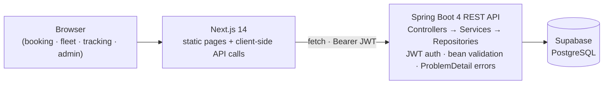

# RoyalTravels 🚖

End-to-end booking and fleet-management platform for a cab & travel agency:
a public customer-facing site for booking and tracking rides, and a
role-based admin dashboard for managing bookings and the fleet.


**Live demo**

| | URL |
|---|---|
| Frontend | https://royaltravels.vercel.app |
| API health | https://royal-travels-api.onrender.com/api/health |
| Interactive API docs | https://royal-travels-api.onrender.com/swagger-ui.html |

Both hosts run on free tiers — the API sleeps after ~15 idle minutes, so the
first request may take up to a minute to wake it.

---

## Architecture



- **Frontend** (`frontend/`) — Next.js App Router, Tailwind, Recharts. Every
  page is statically pre-rendered; all data comes from the API at runtime, so
  the frontend is a pure presentation layer.
- **Backend** (repo root) — single-module Spring Boot REST API. Controllers stay
  thin, business logic lives in services, entities are mapped to DTO records at
  the API boundary and never exposed directly.
- **Database** — managed PostgreSQL with `ddl-auto=validate`: the JPA entities
  are validated against the schema at startup, and all schema changes are
  applied manually (no destructive auto-DDL against shared data).

## Features

**Public site**
- Service-type aware booking form (outstation, local, airport, callback) with
  server-side validation and a generated booking reference
- Optional customer accounts (email + password): signup, login and a
  "My bookings" page. Guest checkout remains available, and bookings made as a
  guest before signing up are linked automatically by phone number
- Booking confirmation + tracking by **booking UUID + phone number** — a
  customer can only see their own booking, never someone else's
- Live fleet catalog fetched from the API, with category/capacity filters
- Honest UI: no fake payment screens or mock GPS — unimplemented features are
  labelled as coming soon

**Admin dashboard** (`/admin`, JWT protected)
- Login with `owner` / `staff` roles
- Booking pipeline: paginated list, search, status / payment / trip-stage
  updates, CSV export, computed pipeline stats
- Fleet CRUD: create, edit, retire vehicles, change availability status
- Analytics derived from real booking and vehicle data (volume, status mix,
  top routes, fleet utilisation)

## API overview

Base URL `/api`. Full contract: `/v3/api-docs` (OpenAPI 3.1) or the Swagger UI.

| Method | Path | Auth | Description |
|---|---|---|---|
| GET | `/health` | — | Liveness + database connectivity |
| POST | `/auth/login` | — | Returns a signed JWT for admin access |
| POST | `/auth/customer/signup` | — | Create a customer account (`201`, returns a customer JWT) |
| POST | `/auth/customer/login` | — | Customer login |
| GET | `/customer/me` | CUSTOMER | Current customer profile |
| GET | `/customer/bookings` | CUSTOMER | Bookings made with the account's phone number |
| POST | `/bookings` | — | Create a booking (`201`, returns id + `createdAt`) |
| POST | `/bookings/lookup` | — | Confirm/track a booking (needs UUID **and** phone) |
| GET | `/vehicles` | — | Active fleet |
| GET | `/vehicles/{id}` | — | Single active vehicle |
| GET | `/bookings` | OWNER/STAFF | Paginated bookings, `?status=` and `?q=` filters |
| GET | `/bookings/{id}` | OWNER/STAFF | Single booking |
| PATCH | `/bookings/{id}` | OWNER/STAFF | Partial update: `status`, `paymentStatus`, `tripStage` |
| GET/POST | `/admin/vehicles` | OWNER/STAFF | List all / create vehicle |
| PUT/DELETE | `/admin/vehicles/{id}` | OWNER/STAFF | Update / delete vehicle |

Errors use RFC 7807 `application/problem+json` via a global exception handler.

### Security model

- Stateless JWT authentication (`Authorization: Bearer …`), CSRF disabled by
  design for a token-based API
- Roles are stored lowercase in the token (`owner`, `staff`) and mapped to
  `ROLE_OWNER` / `ROLE_STAFF` authorities; admin endpoints enforce
  `@PreAuthorize("hasAnyRole('OWNER','STAFF')")`
- Every public route is an explicit allow-list entry in `SecurityConfig` —
  anything not listed requires authentication
- The public booking lookup requires *both* the booking UUID and the phone
  number used to create it, so guessing an id reveals nothing
- Request payloads are DTO records with Bean Validation constraints; callers
  cannot set server-owned values (ids, timestamps, statuses, fares)

## Getting started

**Backend** (Java 21, port 8081)

```bash
./mvnw spring-boot:run        # Linux/Git Bash
.\mvnw.cmd spring-boot:run    # Windows
```

Connection details come from environment variables; for local development the
app reads `config/application-local.properties` (gitignored) automatically.
See [DEPLOYMENT.md](DEPLOYMENT.md) for the full variable list.

**Frontend** (Node 18+, port 3000)

```bash
cd frontend
npm install
cp .env.local.example .env.local   # point NEXT_PUBLIC_API_BASE_URL at the API
npm run dev
```

**Seed data**

```bash
psql "$DB_URL" -f db/seed_vehicles.sql   # 6 demo vehicles (idempotent by plate)
psql "$DB_URL" -f db/demo_bookings.sql   # demo bookings for the dashboard (idempotent)
```

## Engineering decisions

- **DTO records at the boundary.** Entities never leave the service layer, so
  adding a column never leaks into the API contract by accident.
- **`ddl-auto=validate`, no auto-migrations.** The database is shared and
  treated as production data; schema changes are deliberate, applied SQL.
- **No public UUID-only booking lookup.** The obvious "track by id" endpoint
  leaks names, phones and routes to anyone with a UUID. Requiring the phone
  number makes the confirmation page safe to share in an SMS.
- **Server-owned booking fields.** `BookingRequest` has no id/status/fare
  fields, so a crafted public POST cannot inject admin-only state.
- **Free-tier-aware health probe.** `/api/health` opens a real database
  connection, so an uptime ping keeps both the API container and the managed
  Postgres project warm.
- **Honest scope.** Payments, driver accounts and live GPS are *not* faked in
  the UI; the roadmap below lists them as future work.

## Performance, scale and abuse protection

The three "cheap wins" that keep the public API fast and safe, each one a
self-contained concept worth learning:

- **Rate limiting** (`RateLimitFilter`) — a fixed-window counter per client IP
  protects the unauthenticated write routes: 10 login attempts / 5 min,
  20 bookings / 10 min, 60 lookups / 10 min. Exceeding the budget returns
  `429 Too Many Requests` with a `Retry-After` header. The concept to learn:
  token-bucket vs fixed-window vs sliding-window algorithms, and why a
  multi-instance deployment needs a shared store (Redis) or an edge limiter
  instead of per-process memory.
- **TTL cache + write-through invalidation** (`VehicleService`) — the public
  fleet catalog is served from an immutable in-process snapshot that is at most
  60 seconds old; every admin create/update/delete evicts it immediately. Plus
  `Cache-Control: max-age=60` on the response, so browsers and CDNs reuse it
  too. Concepts: cache stampede, TTL vs explicit invalidation, CDN caching.
- **Database indexes** (`db/indexes.sql`) — composite `(status, created_at DESC)`
  for the admin list sort/filter, and **trigram GIN indexes** (`pg_trgm`)
  that make `LIKE '%text%'` searches sargable, which plain B-tree indexes
  cannot do. Concepts: B-tree vs GIN indexes, sargability, `EXPLAIN ANALYZE`.

Also relevant: `readOnly` transactions (lets Postgres/Hibernate skip
write-related work), `open-in-view=false` (connections return to the pool
before response serialization), and bounded pagination (no unbounded result
sets).

## Roadmap

- Razorpay/payment-gateway integration with reconciled `paymentStatus`
- Driver mobile flow with live GPS (`drivers` table and location columns exist)
- Email/SMS notifications on booking status change
- Flyway migrations to replace manual SQL
- Testcontainers-based integration tests against an ephemeral database

## License

MIT
