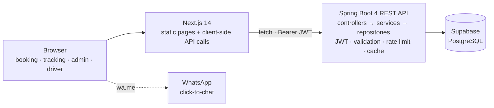

# RoyalTravels 🚖

A booking and fleet-operations platform for a cab and travel agency: a public
site for booking and tracking rides, a role-based admin console for dispatch and
fleet management, and a passwordless trip sheet for drivers.


> **Project status:** a working full-stack platform, ready for a portfolio demo
> and a small-business pilot with manual payments. Online payments, live GPS,
> and automated notifications are intentionally not built and are labelled as
> future work — not mocked.

---

## Contents

- [What it does](#what-it-does)
- [Architecture](#architecture)
- [Features](#features)
- [Tech stack](#tech-stack)
- [Quickstart](#quickstart)
- [API overview](#api-overview)
- [Engineering decisions](#engineering-decisions)
- [Security, performance, and abuse protection](#security-performance-and-abuse-protection)
- [Testing and CI](#testing-and-ci)
- [Deployment](#deployment)
- [Documentation](#documentation)
- [Roadmap](#roadmap)
- [License](#license)

---

## What it does

A small agency typically runs on phone calls and WhatsApp. Bookings get retyped,
duplicates slip through, nobody can see the pipeline, and customers call to ask
"where is my cab?".

RoyalTravels fixes the operational loop:

1. **A guest books** in under a minute — no account required.
2. **The request lands in a real pipeline** with validation, duplicate
   protection, and a generated reference.
3. **Dispatch assigns a driver** from a roster and sends the full trip brief
   through free WhatsApp click-to-chat.
4. **The driver opens a trip sheet** with the reference and their phone, calls
   the guest, opens the route in Google Maps, and marks the trip started or
   completed.
5. **The customer tracks the trip** with the reference and the booking phone —
   no account and no leaked data.

Nothing is faked: there is no payment screen, no GPS animation, and no
"notification sent" claim when a human still has to press send.

---

## Architecture



| Layer | Responsibility |
|---|---|
| **Frontend** (`frontend/`) | Next.js App Router, Tailwind, Recharts. Pages are statically pre-rendered; all data comes from the API at runtime. |
| **Backend** (repo root) | Spring Boot REST API. Controllers stay thin, business logic lives in services, entities are mapped to DTO records at the boundary. |
| **Database** | Managed PostgreSQL with `ddl-auto=validate`. Schema changes are reviewed SQL, never automatic DDL. |

Read [docs/architecture.md](docs/architecture.md) for request flows, state
models, failure modes, and the scaling path.

---

## Features

### Public site

- Service-aware booking form for **outstation, local, airport, and callback**
  trips, with server-side validation and a generated reference.
- Duplicate protection: the same guest, phone, service, and pickup date/time
  within 10 minutes returns the original reference instead of creating a second
  row.
- Confirmation and tracking by **booking UUID + phone number**, so a forwarded
  link reveals nothing on its own.
- Tracking refreshes every 30 seconds and reflects driver progress.
- Live fleet catalogue with category and capacity filters.
- Optional customer accounts (email + password), booking history, and automatic
  linking of guest bookings by phone. Guest checkout remains the default.
- Honest UI: unimplemented features are labelled, not simulated.

### Admin console (`/admin`, JWT protected)

- Login with `owner` / `staff` roles and self-service password change.
- Paginated booking pipeline with search, status/payment/trip-stage filters, CSV
  export, and computed stats.
- **Driver roster**: name, WhatsApp number, vehicle, licence status,
  availability.
- **Assign or unassign a driver** directly on a booking.
- **WhatsApp trip handoff**: one click opens a complete trip brief addressed to
  the assigned driver, including a trip-sheet link. No Business API, no
  per-message cost.
- Fleet CRUD with active/maintenance/inactive status.
- Analytics derived from real bookings and fleet data.
- Responsive layout, error boundary, custom 404, and accessible controls.

### Driver (`/driver/trip`)

- Passwordless access with the booking reference and the assigned driver's
  phone.
- Guest contact buttons, Google Maps route, flight and pickup details.
- Start and complete actions that update the booking and the driver's
  availability, and are visible on customer tracking.

---

## Tech stack

| Layer | Technology |
|---|---|
| API | Java 21, Spring Boot 4.1.1, Spring Security, Spring Data JPA |
| Auth | Stateless JWT (jjwt 0.12.6), BCrypt, method-level roles |
| Database | PostgreSQL on Supabase, trigram GIN indexes, `CHECK` constraints |
| Docs | springdoc-openapi 3.1.1, Swagger UI, OpenAPI 3.1 |
| Frontend | Next.js 14.2 App Router, React 18, TypeScript, Tailwind CSS, Recharts |
| Build | Maven Wrapper, npm, multi-stage Docker |
| Hosting | Render (API), Vercel (frontend), Supabase (database) |
| CI | GitHub Actions: backend package + frontend production build |

---

## Quickstart

### Prerequisites

- Java 21
- Node.js 18+ (20 recommended)
- A Supabase PostgreSQL database with the schema applied (see
  [docs/database.md](docs/database.md))

### Backend

```powershell
# Windows
.\mvnw.cmd spring-boot:run
```

```bash
# Linux / Git Bash
./mvnw spring-boot:run
```

The API starts on **http://localhost:8081**. Configuration is read from
environment variables; local values live in `config/application-local.properties`
(gitignored). See [`.env.example`](.env.example) for the full list.

| URL | Purpose |
|---|---|
| `/api/health` | Liveness + database check |
| `/api/vehicles` | Public fleet |
| `/swagger-ui.html` | Interactive API docs |
| `/v3/api-docs` | OpenAPI JSON |

### Frontend

```powershell
cd frontend
npm install
Copy-Item .env.local.example .env.local   # NEXT_PUBLIC_API_BASE_URL=http://localhost:8081
npm run dev
```

Open **http://localhost:3000**.

### Seed data

```powershell
psql "$env:DB_URL" -f db/seed_vehicles.sql
psql "$env:DB_URL" -f db/demo_bookings.sql   # demo environments only
```

Both scripts are idempotent.

### Default local admin

The backend creates one owner on first start **if** `ADMIN_EMAIL` and
`ADMIN_PASSWORD` are set and that email does not already exist. Local development
uses the values in `config/application-local.properties`. Never reuse the local
password in production.

---

## API overview

Base path `/api`. Full contract: `/v3/api-docs` or the Swagger UI. Detailed
reference with examples: [docs/api.md](docs/api.md).

| Method | Path | Auth | Description |
|---|---|---|---|
| GET | `/health` | — | Liveness + database connectivity |
| POST | `/auth/login` | — | Admin login, returns a JWT |
| POST | `/auth/customer/signup` | — | Create a customer account |
| POST | `/auth/customer/login` | — | Customer login |
| GET | `/customer/me` | CUSTOMER | Current customer profile |
| GET | `/customer/bookings` | CUSTOMER | Bookings matching the account phone |
| POST | `/bookings` | — | Create a booking |
| POST | `/bookings/lookup` | — | Confirm/track (UUID **and** phone) |
| GET | `/bookings` | OWNER/STAFF | Paginated list, `?status=` and `?q=` |
| GET | `/bookings/{id}` | OWNER/STAFF | Single booking |
| PATCH | `/bookings/{id}` | OWNER/STAFF | `status`, `paymentStatus`, `tripStage`, `driverId` |
| GET | `/vehicles` | — | Active fleet |
| GET | `/vehicles/{id}` | — | Single active vehicle |
| GET/POST | `/admin/vehicles` | OWNER/STAFF | List all / create |
| PUT/DELETE | `/admin/vehicles/{id}` | OWNER/STAFF | Update / delete |
| GET/POST | `/admin/drivers` | OWNER/STAFF | Roster / add driver |
| PUT/DELETE | `/admin/drivers/{id}` | OWNER/STAFF | Update / remove unassigned driver |
| POST | `/admin/password` | OWNER/STAFF | Change the signed-in password |
| POST | `/driver/trips/lookup` | — | Driver trip sheet (UUID **and** driver phone) |
| PATCH | `/driver/trips/{id}/stage` | — | Driver marks started/completed |

Errors are RFC 7807 `application/problem+json` via a global exception handler.
Rate-limited routes return `429` with `Retry-After`.

---

## Engineering decisions

- **DTO records at the boundary.** Entities never leave the service layer, so a
  new column cannot leak into the API by accident.
- **`ddl-auto=validate`, no automatic migrations.** The database is shared and
  treated as production data. Schema changes are deliberate SQL, applied and
  reviewed.
- **No UUID-only booking lookup.** "Track by id" would leak names, phones, and
  routes to anyone with a link. Requiring the phone makes the confirmation page
  safe to forward.
- **Server-owned booking fields.** `BookingRequest` has no id, status, or fare
  fields, so a crafted public POST cannot set admin-only state.
- **Guest-first.** Accounts are optional; the booking form is the product.
- **Passwordless drivers.** The trip reference plus the roster phone is the
  access check. No password resets for a WhatsApp-first workforce.
- **Free WhatsApp by default.** Click-to-chat needs no Meta verification or
  per-message billing. Automated notifications would require the paid Business
  API; the UI says so instead of implying otherwise.
- **Free-tier-aware health probe.** `/api/health` opens a real database
  connection, so an uptime ping keeps both the API container and the Postgres
  project warm.
- **Honest scope.** Payments, GPS, and automated notifications are future work.
  Nothing is mocked.

The reasoning behind each major choice is recorded in
[docs/adr/](docs/adr/README.md).

---

## Security, performance, and abuse protection

### Security model

- Stateless JWT authentication, 8-hour expiry, CSRF disabled by design for a
  bearer-token API.
- Roles are stored lowercase in the token (`owner`, `staff`, `customer`) and
  mapped to Spring authorities. Admin routes enforce `@PreAuthorize`.
- Every public route is an explicit allow-list entry in `SecurityConfig`;
  everything else requires authentication.
- Booking lookup requires the UUID **and** the phone used at booking time.
  Driver trip access requires the UUID **and** the assigned driver's phone.
- Wrong secret and missing record return the same `404`; login does not
  distinguish an unknown email from a wrong password.
- BCrypt password hashes, server-owned fields, Bean Validation, and database
  `CHECK` constraints.

Read [docs/security.md](docs/security.md) for the threat model, accepted risks,
and the production hardening checklist.

### Performance and abuse protection

- **Rate limiting** (`RateLimitFilter`) — per-IP fixed windows on unauthenticated
  writes: login 10/5 min, customer login 10/5 min, signup 5/hour, bookings
  20/10 min, booking lookup 60/10 min, driver lookup 60/10 min. Returns `429` +
  `Retry-After`.
- **TTL cache + write-through invalidation** (`VehicleService`) — the public
  fleet is served from an immutable snapshot at most 60 seconds old; admin writes
  evict immediately. The response also sets `Cache-Control: max-age=60`.
- **Database indexes** (`db/indexes.sql`) — composite `(status, created_at DESC)`
  for the admin list, trigram GIN indexes for leading-wildcard search, and a
  status index for the fleet.
- `readOnly` transactions, `open-in-view=false`, bounded pagination, and a
  duplicate-submission guard.

---

## Testing and CI

| Gate | Command | Result |
|---|---|---|
| Backend package | `.\mvnw.cmd -DskipTests clean package` | BUILD SUCCESS |
| Frontend types | `npx tsc --noEmit` | No errors |
| Frontend build | `npm run build` | 20 routes |
| E2E smoke | `node scripts/e2e-smoke.mjs` | 43/43 checks |

The E2E suite exercises health, fleet caching, booking creation and validation,
phone-verified lookup, CORS, admin auth and pagination, status updates, fleet
CRUD, driver roster, assignment, trip-sheet authorization, stage transitions,
password change, customer signup/history, and role isolation.

> The suite inserts test rows. Run it against staging or clean up afterwards with
> `scripts/cleanup-test-data.sql`. Never run it against real customer data.

CI ([`.github/workflows/ci.yml`](.github/workflows/ci.yml)) runs the backend
package and the frontend production build on every push and pull request. See
[docs/testing.md](docs/testing.md) for the strategy and known gaps.

---

## Deployment

The full production procedure — Render Blueprint, Vercel, Supabase, CORS,
verification, keep-alive, custom domains, rollback, and troubleshooting — is in
**[docs/deployment.md](docs/deployment.md)**. A short quickstart is in
[DEPLOYMENT.md](DEPLOYMENT.md).

**Live URLs:** production URLs are environment-specific and are recorded here
after the first deployment. The runbook is complete; the providers are not yet
provisioned for this repository.

| Environment | Frontend | API |
|---|---|---|
| Local | `http://localhost:3000` | `http://localhost:8081` |
| Production | `<your-project>.vercel.app` | `<your-service>.onrender.com` |

Zero-cost pilot stack: Supabase Free + Render Free (Docker) + Vercel Hobby.
Free-tier caveats and the paid upgrade path are documented in
[ADR 0006](docs/adr/0006-free-tier-hosting.md).

---

## Documentation

| Document | What it covers |
|---|---|
| [docs/README.md](docs/README.md) | Documentation index and conventions |
| [Product overview](docs/product.md) | Problem, users, scope, journeys, business rules |
| [Architecture](docs/architecture.md) | Components, request flows, state model, scaling |
| [API reference](docs/api.md) | Auth, errors, rate limits, every endpoint with examples |
| [Database](docs/database.md) | Schema, constraints, indexes, migrations, backups |
| [Deployment](docs/deployment.md) | Full production runbook |
| [Operations](docs/operations.md) | Monitoring, incident runbooks, routines, support |
| [Security](docs/security.md) | Threat model, controls, accepted risks |
| [Testing](docs/testing.md) | Gates, E2E coverage, manual QA, future plan |
| [Development](docs/development.md) | Local setup, conventions, common tasks |
| [Roadmap](docs/roadmap.md) | What is next and what is intentionally out of scope |
| [ADRs](docs/adr/README.md) | Why the major technical decisions were made |
| [Contributing](CONTRIBUTING.md) | Branch, commit, review, and release workflow |
| [Security policy](SECURITY.md) | Private vulnerability reporting |
| [Changelog](CHANGELOG.md) | Release history |

---

## Roadmap

**Now:** deploy and verify, rotate secrets, publish privacy/terms/refund pages,
add the real fleet and drivers, add service-level unit tests.

**Next:** Flyway migrations, Testcontainers + CI tests, Telegram/email
notifications, Playwright for the main journeys, payment links, observability.

**Later:** live GPS, WhatsApp Business API, admin 2FA and audit log, invoicing,
multi-tenant support, PWA.

Full detail and prioritisation rules: [docs/roadmap.md](docs/roadmap.md).

---

## License

MIT — see [LICENSE](LICENSE).
