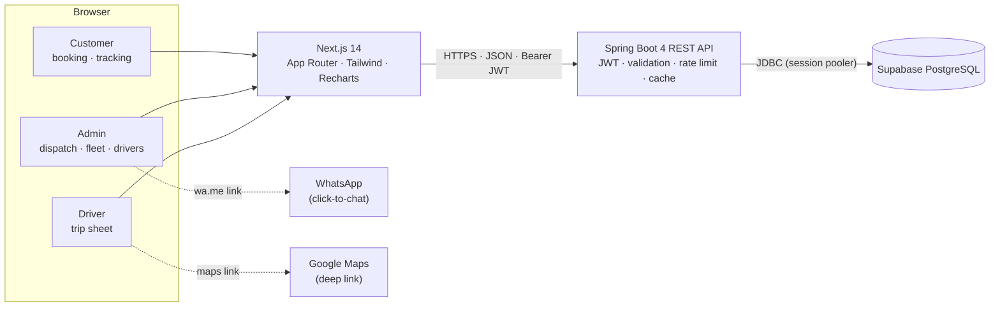
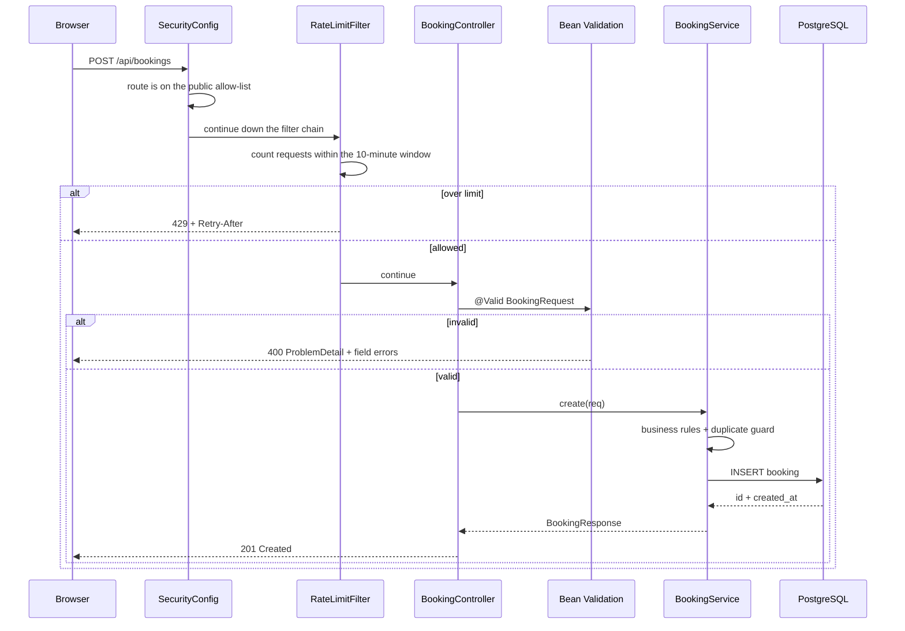
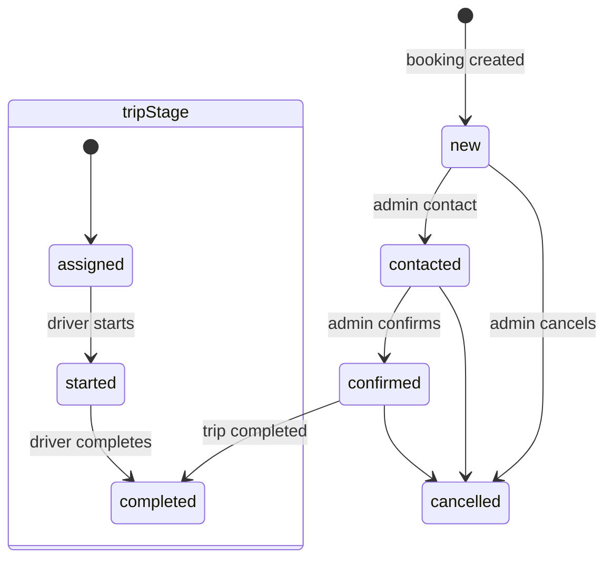

# Architecture

## 1. Summary

RoyalTravels is a **modular monolith** with two deployable units:

1. a Spring Boot REST API that owns all business rules and persistence;
2. a Next.js single-page-style web application that renders the public site,
   admin console, and driver trip sheet.

The API is stateless. The frontend is statically pre-rendered and fetches data at
runtime. PostgreSQL (Supabase) is the only stateful dependency.



Why a monolith: the domain is small, the team is small, and every feature
currently touches the same booking lifecycle. Splitting into services would add
network boundaries, distributed transactions, and deployment overhead without a
scaling need. See [ADR 0001](adr/0001-modular-monolith.md).

---

## 2. Technology stack

| Layer | Technology | Version | Why |
|---|---|---|---|
| Language | Java | 21 (LTS) | Records, pattern matching, long-term support |
| API framework | Spring Boot | 4.1.1 | Mature security, JPA, validation, observability |
| Security | Spring Security + jjwt | 0.12.6 | Stateless JWT, method-level roles |
| Persistence | Spring Data JPA / Hibernate | Boot-managed | Repository abstraction, derived queries |
| Database | PostgreSQL (Supabase) | Managed | Relational integrity, trigram search |
| API docs | springdoc-openapi | 3.1.1 | OpenAPI 3.1 + Swagger UI |
| Build | Maven Wrapper | Maven 3.10 | Reproducible builds without a local Maven install |
| Frontend | Next.js (App Router) | 14.2.35 | Static pre-render + client data fetching |
| UI | React + Tailwind CSS | 18 / 3.4 | Small bundle, responsive layout |
| Charts | Recharts | 2.12 | Admin analytics |
| Container | Docker multi-stage | — | Reproducible runtime image |
| Hosting | Render + Vercel + Supabase | Free tiers | Zero recurring cost for a pilot |

---

## 3. Backend architecture

### 3.1 Layering

```text
HTTP request
   │
   ├─ SecurityConfig / JwtAuthFilter   public allow-list; parses the Bearer token
   ├─ RateLimitFilter                  fixed-window limit on the public write routes
   │
   ├─ Controller               HTTP mapping, @Valid, @PreAuthorize, status codes
   ├─ Service                  business rules, transactions, cache, duplicate guard
   ├─ Repository               Spring Data JPA / JPQL
   ├─ Entity                   persistence model (never serialized directly)
   └─ DTO record               API boundary contract (from(...) mapper)

Errors ── GlobalExceptionHandler ── RFC 7807 ProblemDetail
```

The Spring Security chain runs before the application's servlet filters. The
rate limiter therefore applies to requests that have already passed the public
allow-list; private routes are rejected with `401` before the limiter is
consulted, which is the intended behaviour.

Rules of the layering:

- Controllers never contain business logic and never expose entities.
- Services return DTOs, not entities.
- Repositories are the only place that knows about JPQL.
- Entities are mapped to records at the service boundary.

### 3.2 Package map

| Package / class | Responsibility |
|---|---|
| `RoyalTravelsApplication` | Entry point |
| `SecurityConfig` | Filter chain, public allow-list, CORS, BCrypt |
| `JwtService` | Sign and parse 8-hour HMAC JWTs |
| `JwtAuthFilter` | Extract `Authorization: Bearer`, map role to authority |
| `RateLimitFilter` | Per-IP fixed window on the public write routes |
| `AdminBootstrap` | Create the first `owner` if `ADMIN_EMAIL` is absent |
| `BookingController` / `BookingService` | Booking lifecycle, lookup, duplicate guard |
| `VehicleController` / `VehicleService` | Fleet CRUD, public cache and eviction |
| `DriverController` / `DriverService` | Roster CRUD, trip authorization, stage updates |
| `DriverTripController` | Public, phone-verified driver trip sheet |
| `CustomerController` / `CustomerService` | Optional customer accounts and history |
| `AuthController` / `AuthService` | Admin login and password change |
| `AdminController` | Password change endpoint |
| `HealthController` | Liveness + database connectivity |
| `GlobalExceptionHandler` | Uniform RFC 7807 error responses |
| `dto/*` | Request/response records with Bean Validation |
| `exception/*` | API error mapping |

### 3.3 Request lifecycle (booking creation)



### 3.4 State model



`status`, `paymentStatus`, and `tripStage` are separate fields. They are not
derived from each other because dispatch and driving progress are separate
concerns. The driver completing a trip sets `tripStage=completed` **and**
`status=completed`; starting a trip sets `status=confirmed` unless it is already
completed.

---

## 4. Frontend architecture

### 4.1 Rendering model

Every route is statically pre-rendered at build time. Interactive pages opt into
client rendering with `"use client"` and fetch data from the API in the browser.
There is no server-side session, no Next.js API route, and no BFF layer.

Consequences:

- The frontend can be hosted on any static/CDN host, including Vercel.
- `NEXT_PUBLIC_API_BASE_URL` is baked into the bundle at build time, so changing
  the API URL requires a rebuild.
- Admin JWTs live in `sessionStorage`, not cookies, so the API cannot set
  `HttpOnly` cookies. This is a deliberate trade-off for a separate-origin SPA.

### 4.2 Routes

| Route | Audience | Purpose |
|---|---|---|
| `/` | Public | Landing page, hero, services, fleet preview, booking bar |
| `/fleet` | Public | Full fleet with category/capacity filters |
| `/confirmation?id=` | Public | Booking confirmation (uses cached booking) |
| `/track?id=` | Public | Phone-verified tracking with 30-second refresh |
| `/account/login` | Customer | Sign in |
| `/account/signup` | Customer | Create account |
| `/account` | Customer | Profile and booking history |
| `/admin/login` | Admin | JWT login |
| `/admin` | Admin | Dashboard and pipeline summary |
| `/admin/bookings` | Admin | Booking list, filters, driver assignment, CSV |
| `/admin/fleet` | Admin | Fleet CRUD |
| `/admin/drivers` | Admin | Driver roster |
| `/admin/analytics` | Admin | Volume, status mix, routes, utilisation |
| `/admin/settings` | Admin | Password change and session details |
| `/driver/login` | Driver | Entry point explaining the trip-sheet flow |
| `/driver/trip?id=` | Driver | Phone-verified trip sheet and stage actions |

### 4.3 Frontend modules

| File | Responsibility |
|---|---|
| `lib/api.ts` | Typed API client, one function per endpoint, shared `ApiError` |
| `lib/auth.ts` | Admin session in `sessionStorage` |
| `lib/customerAuth.ts` | Customer session in `sessionStorage` |
| `lib/bookingSession.ts` | Last booking cache used by the confirmation page |
| `lib/format.ts` | INR, date, 12-hour time, short reference, WhatsApp link |
| `components/BookingBar.tsx` | Booking form and client-side validation |
| `components/Header.tsx` | Responsive navigation with mobile menu |
| `components/LiveTracking.tsx` | Tracking timeline and polling |
| `components/admin/AdminShell.tsx` | Admin layout guard and chrome |
| `app/error.tsx` | Route error boundary |
| `app/not-found.tsx` | Custom 404 |

### 4.4 Error handling

`lib/api.ts` parses the API's `ProblemDetail` body into an `ApiError` with
`status`, `message`, and optional field `errors`. Components display the message
and map field errors to inputs. Network failures are reported as a specific
"Cannot reach the API" message rather than a generic error.

---

## 5. Cross-cutting concerns

| Concern | Implementation | Trade-off |
|---|---|---|
| Authentication | Stateless JWT, 8-hour expiry, HMAC-SHA | No server-side revocation; rotate the secret to invalidate all sessions |
| Authorization | `@PreAuthorize` roles at controller level | Role checks are coarse; no per-record ACL |
| Input validation | Bean Validation + service business rules | Two places to keep in sync when enums change |
| Error contract | RFC 7807 `ProblemDetail` | The 401 from the security entry point is a plain servlet error |
| CORS | Explicit origin list from `CORS_ALLOWED_ORIGINS` | Exact origin required; no wildcard |
| Rate limiting | In-process fixed window | Does not span multiple instances |
| Caching | 60-second in-process fleet snapshot + write-through eviction | Each instance has its own snapshot |
| Persistence | `ddl-auto=validate`, manual SQL | No automated migrations; schema changes are deliberate |
| Observability | Health endpoint + stdout logs | No metrics/tracing backend |
| Secrets | Environment variables, local file gitignored | No secret manager on the free tier |

---

## 6. Failure modes

| Failure | Effect | Mitigation |
|---|---|---|
| Database unreachable | `/api/health` returns `degraded`; all data routes fail | Supabase status page; connection pooler; restart after outage |
| API cold start | First request after idle takes 30–60 s | Keep-alive ping every 10 minutes; paid instance if unacceptable |
| API down | Frontend shows a clear "cannot reach API" message | Render restart; redeploy previous image |
| JWT secret rotated | All existing sessions become invalid | Expected; users sign in again |
| Admin password lost | No self-service recovery | Rotate `ADMIN_PASSWORD` with a new email, or update the hash directly in the database |
| Vehicle cache stale | Up to 60 s old | Admin writes evict immediately; TTL bounds the rest |
| Rate limit hit | `429` with `Retry-After` | Wait, or raise the limit in `RateLimitFilter` |
| Duplicate booking | `409` with original reference | Customer uses the confirmation page |

---

## 7. Scaling path

The current design is right-sized for a single agency and a single API instance.

| Pressure | First step | Next step |
|---|---|---|
| Read traffic on fleet | Already cached 60 s | CDN cache; longer TTL with explicit purge |
| More API instances | Render paid instance + shared Redis for rate limit/cache | Move rate limiting to the edge (Cloudflare/nginx) |
| Database size | Add indexes; archive old bookings | Paid Supabase tier; read replica |
| Notification volume | Manual WhatsApp | WhatsApp Business Cloud API or Telegram bot |
| File uploads | None today | Object storage (S3/R2) + signed URLs |
| Multi-agency | Not supported | Tenant column + row-level security, or separate deployments |

Do not add microservices before there is a measured bottleneck. The first real
constraint will be operations (one person supporting the platform), not compute.

---

## 8. Related decisions

- [ADR 0001 — Modular monolith](adr/0001-modular-monolith.md)
- [ADR 0002 — Managed PostgreSQL and manual migrations](adr/0002-managed-postgres-manual-migrations.md)
- [ADR 0003 — Stateless JWT and guest-first booking](adr/0003-stateless-jwt-guest-first.md)
- [ADR 0004 — Phone-verified lookup](adr/0004-phone-verified-lookup.md)
- [ADR 0005 — WhatsApp click-to-chat](adr/0005-whatsapp-click-to-chat.md)
- [ADR 0006 — Free-tier hosting](adr/0006-free-tier-hosting.md)
- [ADR 0007 — Single-instance cache and limiter](adr/0007-single-instance-cache-and-limiter.md)
