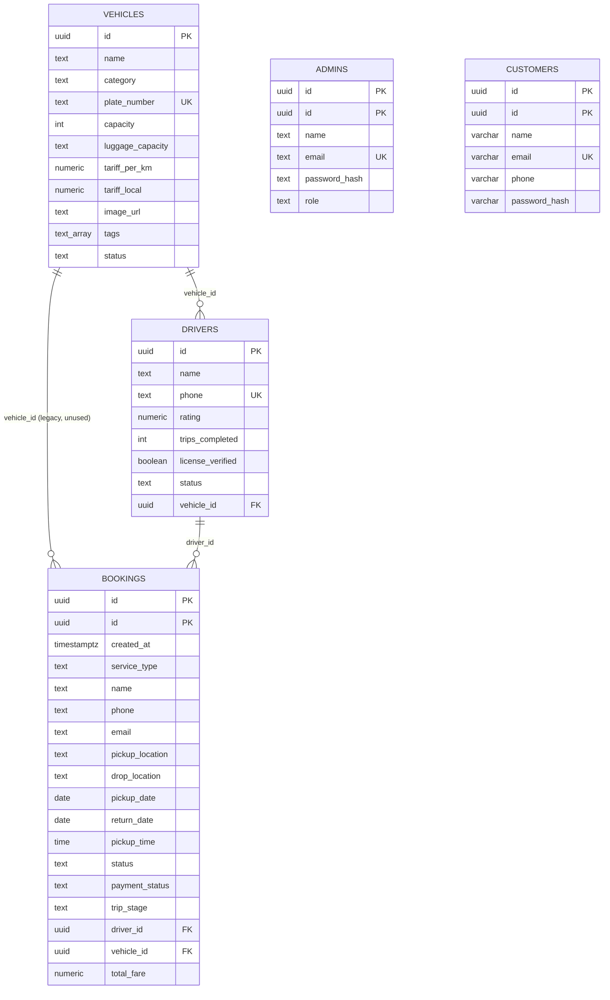

# Database

**Engine:** PostgreSQL (Supabase, managed)
**Schema:** `public`
**ORM:** Spring Data JPA / Hibernate
**DDL mode:** `spring.jpa.hibernate.ddl-auto=validate`
**Migrations:** manual SQL in `db/` — there is no Flyway or Liquibase

The database is treated as production data. Hibernate validates that the
entities match the schema at startup and refuses to start on a mismatch. It never
creates or alters tables.

---

## 1. Entity-relationship model



`bookings.vehicle_id`, `bookings.current_lat`, and `bookings.current_lng` exist in
the schema but are not used by the current application. They are reserved for a
future vehicle assignment and live-tracking feature.

---

## 2. Tables

### 2.1 `bookings`

The core operational table. One row per booking request.

| Column | Type | Null | Default | Notes |
|---|---|---|---|---|
| `id` | `uuid` | no | `gen_random_uuid()` | Primary key; the public booking reference |
| `created_at` | `timestamptz` | no | `now()` | Set by Hibernate `@CreationTimestamp` |
| `service_type` | `text` | no | — | `outstation`, `local`, `airport`, `callback` |
| `name` | `text` | no | — | Guest name |
| `phone` | `text` | no | — | Primary contact and lookup secret |
| `email` | `text` | yes | — | Optional |
| `pickup_location` | `text` | yes | — | Required by business rules for most services |
| `drop_location` | `text` | yes | — | Required for outstation/airport |
| `trip_type` | `text` | yes | — | Free text, e.g. `one-way`, `round-trip` |
| `return_date` | `date` | yes | — | Required for outstation round trips |
| `package` | `text` | yes | — | Mapped as `packageType` in the API because `package` is reserved in Java |
| `transfer_type` | `text` | yes | — | Airport arrival/departure |
| `flight_number` | `text` | yes | — | Airport pickups |
| `pickup_date` | `date` | yes | — | Cannot be in the past |
| `pickup_time` | `time` | yes | — | Local time, no timezone |
| `vehicle_preference` | `text` | yes | — | Customer preference, not an assignment |
| `passengers` | `text` | yes | — | Kept as text for "4 + 1 child" style input |
| `preferred_call_time` | `text` | yes | — | Callback window |
| `notes` | `text` | yes | — | Max 1000 chars at the API |
| `base_fare` | `numeric` | yes | — | Server-owned; not set by the public API |
| `total_fare` | `numeric` | yes | — | Server-owned |
| `advance_amount` | `numeric` | yes | — | Server-owned |
| `vehicle_id` | `uuid` | yes | — | FK to `vehicles`; unused by the app today |
| `driver_id` | `uuid` | yes | — | FK to `drivers`; assigned by dispatch |
| `current_lat` | `numeric` | yes | — | Reserved for live GPS |
| `current_lng` | `numeric` | yes | — | Reserved for live GPS |
| `trip_stage` | `text` | yes | `'assigned'` | `assigned`, `started`, `completed` |
| `payment_status` | `text` | no | `'pending'` | `pending`, `paid` |
| `status` | `text` | no | `'new'` | `new`, `contacted`, `confirmed`, `completed`, `cancelled` |

Constraints:

- `bookings_pkey` — primary key on `id`
- `bookings_driver_id_fkey` — `driver_id` references `drivers(id)`
- `bookings_vehicle_id_fkey` — `vehicle_id` references `vehicles(id)`
- `bookings_service_type_check`
- `bookings_status_check`
- `bookings_payment_status_check`
- `bookings_trip_stage_check`

### 2.2 `vehicles`

| Column | Type | Null | Default | Notes |
|---|---|---|---|---|
| `id` | `uuid` | no | `gen_random_uuid()` | PK |
| `created_at` | `timestamptz` | no | `now()` | Not mapped by the entity |
| `name` | `text` | no | — | Display name |
| `category` | `text` | no | — | Sedan, SUV, MPV, Van, Coach… |
| `plate_number` | `text` | no | — | **Unique** |
| `capacity` | `int` | no | — | 1–100 at the API |
| `luggage_capacity` | `text` | yes | — | Display string |
| `tariff_per_km` | `numeric` | no | — | INR |
| `tariff_local` | `numeric` | yes | — | INR, local package |
| `image_url` | `text` | yes | — | Remote image URL |
| `tags` | `text[]` | yes | — | Seeded amenity tags; not exposed by the API |
| `status` | `text` | no | `'active'` | `active`, `maintenance`, `inactive` |

Constraints: `vehicles_pkey`, `vehicles_plate_number_key` (unique),
`vehicles_status_check`.

### 2.3 `drivers`

| Column | Type | Null | Default | Notes |
|---|---|---|---|---|
| `id` | `uuid` | no | `gen_random_uuid()` | PK |
| `created_at` | `timestamptz` | no | `now()` | Set on insert |
| `name` | `text` | no | — | |
| `phone` | `text` | no | — | **Unique**; also the trip-sheet secret |
| `rating` | `numeric` | yes | `5.0` | 0.0–5.0 at the API |
| `trips_completed` | `int` | yes | `0` | Incremented on trip completion |
| `license_verified` | `boolean` | yes | `false` | Dispatch-controlled flag |
| `status` | `text` | no | `'available'` | `available`, `on_trip`, `off_duty` |
| `vehicle_id` | `uuid` | yes | — | FK to `vehicles` |

Constraints: `drivers_pkey`, `drivers_phone_key` (unique),
`drivers_status_check`, `drivers_vehicle_id_fkey`.

Drivers have no accounts, no password hash, and no token. Authorization is the
booking reference plus this phone number. See
[ADR 0004](adr/0004-phone-verified-lookup.md).

### 2.4 `customers`

| Column | Type | Null | Default | Notes |
|---|---|---|---|---|
| `id` | `uuid` | no | — | Set by Hibernate (`GenerationType.UUID`) |
| `name` | `varchar(120)` | no | — | |
| `email` | `varchar(160)` | no | — | Stored lowercased |
| `phone` | `varchar(20)` | no | — | Used to link past guest bookings |
| `password_hash` | `varchar(100)` | no | — | BCrypt |
| `created_at` | `timestamptz` | no | `now()` | |

Indexes: `customers_email_unique_idx` on `lower(email)`,
`customers_phone_idx` on `phone`.

There is no foreign key from `bookings` to `customers`. A booking belongs to a
phone number, not to an account. That is what makes guest checkout and
"claim your old bookings by signing up" work with one schema.

### 2.5 `admins`

| Column | Type | Null | Default | Notes |
|---|---|---|---|---|
| `id` | `uuid` | no | `gen_random_uuid()` | |
| `created_at` | `timestamptz` | no | `now()` | Not mapped by the entity |
| `name` | `text` | no | — | |
| `email` | `text` | no | — | **Unique** |
| `password_hash` | `text` | no | — | BCrypt |
| `role` | `text` | no | `'staff'` | `owner`, `staff` |

`ADMIN_EMAIL` / `ADMIN_PASSWORD` create a single `owner` at startup **only if that
email does not already exist**. Changing the environment variable later does not
reset an existing password. Use `/admin/settings` or `POST /api/admin/password`.

---

## 3. Indexes

Indexes applied by [`db/indexes.sql`](../db/indexes.sql) and present in the live
database:

| Index | Table | Definition | Serves |
|---|---|---|---|
| `bookings_created_at_idx` | `bookings` | `(created_at DESC)` | Admin default sort |
| `bookings_status_created_at_idx` | `bookings` | `(status, created_at DESC)` | Status filter + sort |
| `bookings_name_trgm_idx` | `bookings` | GIN `lower(name) gin_trgm_ops` | `LIKE '%name%'` |
| `bookings_phone_trgm_idx` | `bookings` | GIN `phone gin_trgm_ops` | `LIKE '%phone%'` |
| `bookings_email_trgm_idx` | `bookings` | GIN `lower(coalesce(email,'')) gin_trgm_ops` | `LIKE '%email%'` |
| `vehicles_status_idx` | `vehicles` | `(status)` | Public fleet filter |
| `customers_email_unique_idx` | `customers` | unique `lower(email)` | Login, duplicate prevention |
| `customers_phone_idx` | `customers` | `(phone)` | Booking-history match |
| `drivers_phone_key` | `drivers` | unique `(phone)` | Duplicate prevention |
| `vehicles_plate_number_key` | `vehicles` | unique `(plate_number)` | Duplicate prevention |

The live database also contains `idx_bookings_created_at` and
`idx_bookings_service_type`, created before this documentation set existed.
`idx_bookings_created_at` duplicates the coverage of `bookings_created_at_idx`;
`idx_bookings_service_type` is not used by the current query patterns. They are
harmless. Do not drop them during a busy period; if you clean them up, use
`DROP INDEX CONCURRENTLY`.

### Why trigram indexes

`WHERE lower(name) LIKE '%ananya%'` cannot use a B-tree index because the
leading wildcard makes the search non-sargable. A `pg_trgm` GIN index indexes
three-character sequences, so PostgreSQL can still narrow the scan. Verify with:

```sql
EXPLAIN ANALYZE
SELECT * FROM bookings WHERE lower(name) LIKE '%ananya%';
```

Look for a `Bitmap Index Scan` on `bookings_name_trgm_idx` rather than a
sequential scan.

---

## 4. Schema change policy

There is no migration tool. This is deliberate: the database is shared and the
team is small. A broken migration cannot be automatically rolled back by a tool
that was never reviewed.

### 4.1 Rules

1. **Never change `ddl-auto`** to `update` or `create` against this database.
   It can drop or rewrite data and bypass review.
2. **Every schema change is a SQL file** committed under `db/`.
3. **Every script is idempotent** — `IF NOT EXISTS`, guarded inserts.
4. **Additive and backwards compatible first**: add a nullable column or one with
   a default; deploy code that tolerates both shapes; backfill; tighten later.
5. **Take a backup before destructive work.**
6. **Test on a scratch Supabase project or a branch**, not on live data.
7. **Update this document** in the same pull request.

### 4.2 Applying a change

```powershell
# 1. Back up first (see §6)
# 2. Apply through the Supabase SQL editor, or psql:
psql "$env:DB_URL" -f db/your_change.sql

# 3. Verify the column/constraint
psql "$env:DB_URL" -c "\d+ bookings"

# 4. Restart the API and confirm Hibernate validation passes
.\mvnw.cmd spring-boot:run
```

If the app fails at startup with `Schema-validation: missing column`, the entity
and database disagree. Do **not** switch `ddl-auto`; add the missing column or
revert the entity.

### 4.3 Adding an enum value

Changing a status value requires all of these, in one release:

1. `CHECK` constraint in the database.
2. `@Pattern` in the relevant DTO record.
3. Set/constant in the service if one exists.
4. TypeScript union in `frontend/lib/api.ts`.
5. Admin dropdown or badge in the UI.
6. E2E check for the new value.
7. This document and `docs/api.md`.

Forgetting step 3 or 5 is the usual cause of a value that passes validation but
renders as blank.

---

## 5. Seed and demo data

| File | Purpose | Safe on production? |
|---|---|---|
| [`db/seed_vehicles.sql`](../db/seed_vehicles.sql) | Six demo vehicles, idempotent by plate number | Yes; inserts only missing plates |
| [`db/demo_bookings.sql`](../db/demo_bookings.sql) | Seven fixed-UUID demo bookings for dashboards | **No** — demo environments only |
| [`db/customers.sql`](../db/customers.sql) | `customers` table and indexes | Yes, `IF NOT EXISTS` |
| [`db/indexes.sql`](../db/indexes.sql) | Performance indexes | Yes, `IF NOT EXISTS` |
| [`scripts/cleanup-test-data.sql`](../scripts/cleanup-test-data.sql) | Removes rows created by the E2E suite | Yes, scoped to known test values |

Run seeds with a direct SQL client. There is no automatic seeding on startup.

---

## 6. Backup and restore

### 6.1 What to back up

- `bookings` — customer commitments; the most important table.
- `customers` — accounts and password hashes.
- `drivers`, `vehicles` — operational master data.
- `admins` — small, but losing it locks out the console.

### 6.2 Supabase dashboard

Free projects include limited automatic backups. Check
**Database → Backups** in the Supabase dashboard. Do not assume point-in-time
recovery exists on the free plan.

### 6.3 Logical backup with `pg_dump`

```bash
pg_dump "$DB_URL" \
  --no-owner \
  --no-privileges \
  --format=custom \
  --file=royaltravels-$(date +%Y%m%d).dump
```

Restore into a fresh database:

```bash
pg_restore --clean --if-exists --no-owner --no-privileges \
  --dbname="$TARGET_DB_URL" royaltravels-20261106.dump
```

### 6.4 CSV export for non-technical staff

Supabase **Table Editor → Export → CSV** works for `bookings`. The admin UI also
exports a filtered booking list as CSV without exposing the database.

### 6.5 Restore drill

Once per quarter, restore the latest dump into a scratch Supabase project and
boot the API against it. A backup that has never been restored is a hope, not a
backup.

---

## 7. Connection and pooling

| Setting | Value |
|---|---|
| Driver | PostgreSQL JDBC (`org.postgresql`) |
| URL | `jdbc:postgresql://<host>:5432/postgres` |
| Host | Supabase **session pooler** (IPv4-compatible) |
| Username | `postgres.<project-ref>` for the pooler |
| Pool | HikariCP defaults, managed by Spring Boot |
| `open-in-view` | `false` — connections return to the pool before serialization |

The session pooler is used because some networks are IPv4-only and the direct
database host is IPv6-only. Keep the JDBC URL exactly as supplied by Supabase;
do not add pgbouncer query parameters intended for transaction pooling.

---

## 8. Data handling

| Data | Classification | Handling |
|---|---|---|
| Name, phone, email | Personal data | Visible to admins; phone is also the lookup secret |
| Booking route and notes | Personal data | Visible to the assigned driver and admins |
| Password hashes | Sensitive | BCrypt; never returned by any API |
| JWT secret | Secret | Environment only; never logged |
| Database credentials | Secret | Environment/local file only; never committed |

Retention: bookings are kept for operational history. There is no automated
purge. If a customer requests deletion, delete or anonymise their booking rows
and customer row manually, after confirming there is no legal retention
obligation. Record the request and the action taken.

Logs: the API logs errors and constraint violations, not request bodies. Avoid
adding body logging that would capture phone numbers, notes, or passwords.
