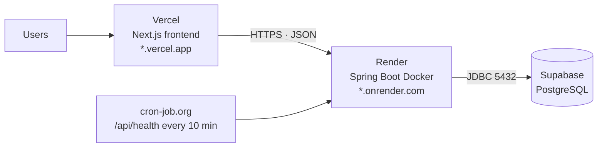

# Deployment runbook

This is the complete production deployment procedure. Follow it top to bottom
for the first deployment. Later releases use §9.

**Target topology (zero recurring cost for a pilot):**



| Component | Provider | Free-tier limit that matters |
|---|---|---|
| Frontend | Vercel Hobby | Non-commercial use; 100 GB bandwidth/month |
| API | Render Free Web Service | 512 MB RAM, 0.1 CPU, sleeps after ~15 min idle, cold start 30–60 s |
| Database | Supabase Free | 500 MB, limited backups, pauses after inactivity |

> **Commercial use:** Vercel Hobby is for personal/non-commercial projects. A
> real business site should use Vercel Pro, Cloudflare Pages, or another host.
> The frontend is a standard Next.js app and does not depend on Vercel-specific
> features.

---

## 1. Pre-flight

Complete these before touching a provider dashboard.

### 1.1 Confirm the repository is clean and pushed

```powershell
git status
git log --oneline -5
git push origin main
```

Render and Vercel deploy from GitHub. Uncommitted local changes do not ship.

### 1.2 Choose production identities

| Value | Rule |
|---|---|
| `ADMIN_EMAIL` | A **new** address you control, e.g. `owner@yourdomain.com`. Do **not** reuse `owner@royaltravels.local`. |
| `ADMIN_PASSWORD` | 16+ characters, generated by a password manager. Never reuse the development password. |
| `JWT_SECRET` | 32+ random bytes. Let Render generate it, or run `openssl rand -base64 48`. |
| `CORS_ALLOWED_ORIGINS` | Starts as `http://localhost:3000`, becomes the Vercel URL after step 4. |

The local development admin password has been shared in chat and is committed
in a gitignored local file. Treat it as compromised and never use it in
production.

### 1.3 Collect the Supabase connection values

From `config/application-local.properties` (gitignored) or Supabase
**Project Settings → Database → Connection string → JDBC**:

```properties
DB_URL=jdbc:postgresql://<host>:5432/postgres
DB_USERNAME=postgres.<project-ref>
DB_PASSWORD=<database password>
```

Use the **session pooler** host on port `5432`. Keep the JDBC prefix; Render
does not translate `postgresql://` URLs for a Java service.

### 1.4 Verify the database is ready

```powershell
# From the repository root, with local config present
.\mvnw.cmd spring-boot:run
```

Wait for `Started RoyalTravelsApplication`. If Hibernate reports a
schema-validation error, fix the schema before deploying. See
[database.md](database.md).

### 1.5 Optional but recommended: rotate the database password

Supabase → **Project Settings → Database → Reset database password**. Update
`config/application-local.properties` and the Render environment variable in the
same sitting, or local development will break.

---

## 2. Deploy the API on Render

### 2.1 Blueprint deployment (recommended)

1. Sign in to [Render](https://render.com) with GitHub.
2. **New → Blueprint**.
3. Select the repository `SaGaru007/RoyalTravels` and branch `main`.
4. Render reads [`render.yaml`](../render.yaml) and shows a service named
   `royal-travels-api` (Docker, Singapore, free, health check `/api/health`).
5. Fill the prompted secrets:

| Variable | Value |
|---|---|
| `DB_URL` | `jdbc:postgresql://<host>:5432/postgres` |
| `DB_USERNAME` | `postgres.<project-ref>` |
| `DB_PASSWORD` | Supabase database password |
| `JWT_SECRET` | Leave the generated value, or paste 48+ random characters |
| `ADMIN_EMAIL` | New production owner email |
| `ADMIN_PASSWORD` | New strong password |
| `CORS_ALLOWED_ORIGINS` | `http://localhost:3000` for now |

6. **Apply / Deploy Blueprint**.
7. Watch the logs until you see:

```text
Started RoyalTravelsApplication in ... seconds
```

8. Open `https://<service-name>.onrender.com/api/health`:

```json
{ "status": "ok", "app": "RoyalTravels", "database": "up" }
```

A first boot can take 60–90 seconds. If the health check fails and the logs show
the JVM still starting, wait; if the logs show an exception, use §11.

### 2.2 Manual service (if you do not use the Blueprint)

1. **New → Web Service** → connect the repository.
2. Runtime: **Docker**. Root directory: repository root.
3. Dockerfile path: `./Dockerfile`.
4. Health check path: `/api/health`.
5. Add the environment variables from the table above plus
   `SPRING_PROFILES_ACTIVE=prod`.
6. Create the service.

### 2.3 Memory tuning on the free instance

The free instance has 512 MB of RAM. The JVM's default heap is a fraction of the
container limit, which can be too small for Spring Boot + Hibernate. The
Blueprint sets:

```yaml
- key: JAVA_TOOL_OPTIONS
  value: -XX:MaxRAMPercentage=70
```

If the service restarts with `OutOfMemoryError`, lower the percentage to `60`,
or move to a paid instance. Do not set a fixed `-Xmx512m`; the container needs
headroom for metaspace, threads, and the OS.

---

## 3. Deploy the frontend on Vercel

1. Sign in to [Vercel](https://vercel.com) with GitHub.
2. **Add New → Project → Import** `SaGaru007/RoyalTravels`.
3. Framework preset: **Next.js**.
4. **Root Directory: `frontend`** — this is the most common deployment mistake.
5. Under **Environment Variables**, add for Production (and Preview if desired):

```text
NEXT_PUBLIC_API_BASE_URL=https://<service-name>.onrender.com
```

6. **Deploy**.
7. Copy the production URL, for example `https://royal-travels.vercel.app`.

`NEXT_PUBLIC_*` variables are inlined at **build time**. Changing the API URL
later requires a new deployment, not just an environment edit.

Command-line alternative:

```bash
cd frontend
npx vercel --prod
```

---

## 4. Allow the frontend origin in the API

Browser requests will fail with a CORS error until this is done.

1. Render → `royal-travels-api` → **Environment**.
2. Set:

```text
CORS_ALLOWED_ORIGINS=https://royal-travels.vercel.app
```

3. Save. Render redeploys automatically; otherwise use **Manual Deploy → Deploy
   latest commit`.
4. Rules:
   - Exact origin: `https://…`, **no trailing slash**, no path.
   - Multiple origins: comma-separated, no spaces required.
   - `http://localhost:3000` may be added for local development against
     production, but remove it before launch if it is not needed.
   - Wildcards are not used.

---

## 5. Production verification

### 5.1 Safe manual checks (no test data left behind)

| Check | Expected |
|---|---|
| `GET https://<api>/api/health` | `200`, `"database":"up"` |
| `GET https://<api>/api/vehicles` | `200`, six seeded vehicles, `Cache-Control: max-age=60` |
| `GET https://<api>/swagger-ui.html` | Swagger UI loads |
| Open the Vercel homepage | Page renders; fleet loads |
| `/fleet`, `/track`, `/driver/trip` | `200` |
| `/admin/login` with the new owner credentials | Dashboard loads |
| Admin → Fleet | Vehicles visible |
| Admin → Drivers | Roster loads; add one test driver |
| Browser DevTools console | No CORS or mixed-content errors |

If the fleet does not render and the console shows a CORS error, revisit §4. If
it shows a network error, check whether the API is awake.

### 5.2 Full E2E suite

The suite creates a booking, a customer, and a driver, then deletes what it can.
It is safe for a staging database, not for a live production database with real
customers.

```powershell
$env:API_BASE_URL="https://<service-name>.onrender.com"
$env:ADMIN_EMAIL="owner@yourdomain.com"
$env:ADMIN_PASSWORD="your-production-password"
node scripts/e2e-smoke.mjs
```

Expected: **43 `PASS` lines**, exit code `0`. If you run it against production,
remove the test rows afterwards:

```bash
psql "$DB_URL" -f scripts/cleanup-test-data.sql
```

### 5.3 First-login tasks

1. Sign in at `/admin/settings` and **change the owner password**.
2. Add real drivers under `/admin/drivers`.
3. Confirm the six seeded vehicles are correct; edit prices or retire vehicles
   that are not part of the real fleet.
4. Run one real booking through the whole flow: guest books → admin assigns
   driver → WhatsApp opens → driver opens trip sheet → starts/completes →
   customer `/track` updates.

---

## 6. Keep the free services warm

Render sleeps after ~15 minutes of inactivity; Supabase free projects pause
after a longer period of inactivity. A health ping addresses both because
`/api/health` opens a database connection.

1. Create a free account at [cron-job.org](https://cron-job.org) or
   UptimeRobot.
2. Create an HTTP monitor:

```text
URL:      https://<service-name>.onrender.com/api/health
Method:   GET
Interval: every 10 minutes
Timeout:  60 seconds
```

3. Enable failure notifications to your email.

This does not make the service always-on; it reduces the chance of a cold start
for the first visitor. For guaranteed latency, use a paid Render instance.

---

## 7. Custom domain (optional)

### Frontend

1. Vercel → Project → **Settings → Domains → Add**.
2. Add `www.yourdomain.com` and `yourdomain.com`.
3. At your DNS provider, create the records Vercel shows (usually `A` for the
   apex and `CNAME` for `www`).
4. Wait for TLS provisioning, then update the API:

```text
CORS_ALLOWED_ORIGINS=https://yourdomain.com,https://www.yourdomain.com
```

### API (optional)

Render → Service → **Settings → Custom Domains**. Add
`api.yourdomain.com`, create the `CNAME`, and update the Vercel
`NEXT_PUBLIC_API_BASE_URL`, then redeploy the frontend.

---

## 8. Environment variable reference

### Backend (Render)

| Variable | Required | Default | Notes |
|---|---|---|---|
| `SPRING_PROFILES_ACTIVE` | yes | `local` | Set to `prod` |
| `DB_URL` | yes | — | JDBC URL, session pooler |
| `DB_USERNAME` | yes | — | `postgres.<project-ref>` |
| `DB_PASSWORD` | yes | — | Supabase password |
| `JWT_SECRET` | yes | — | 32+ bytes; startup fails if missing or short |
| `ADMIN_EMAIL` | no | — | Creates the first owner if absent |
| `ADMIN_PASSWORD` | no | — | Used only when creating that owner |
| `CORS_ALLOWED_ORIGINS` | yes | `http://localhost:3000` | Comma-separated exact origins |
| `PORT` | no | `8081` | Render sets it automatically |
| `JAVA_TOOL_OPTIONS` | recommended | — | `-XX:MaxRAMPercentage=70` |
| `ERROR_INCLUDE_MESSAGE` | no | `never` | Keep `never` in production |
| `ERROR_INCLUDE_BINDING_ERRORS` | no | `never` | Keep `never` in production |

A usable template lives at [`.env.example`](../.env.example).

### Frontend (Vercel)

| Variable | Required | Notes |
|---|---|---|
| `NEXT_PUBLIC_API_BASE_URL` | yes | API origin, no trailing slash; baked at build time |

---

## 9. Release process (after the first deploy)

1. Create a branch; make the change.
2. Run the local gates:

```powershell
.\mvnw.cmd -DskipTests clean package
cd frontend
npx tsc --noEmit
npm run build
```

3. Open a pull request. CI runs the backend package and the frontend build.
4. Merge to `main`.
5. Render and Vercel auto-deploy from `main`.
6. Watch the Render log for `Started RoyalTravelsApplication`.
7. Run the safe checks in §5.1.
8. Tag the release:

```powershell
git tag -a v1.0.1 -m "Release 1.0.1"
git push origin v1.0.1
```

9. Add an entry to [CHANGELOG.md](../CHANGELOG.md).

For a database change, apply the SQL **before** deploying code that requires it,
and keep the change backwards compatible during the rollout window.

---

## 10. Rollback

### Frontend

Vercel → Project → **Deployments** → select the previous deployment →
**Promote to Production**. No rebuild required.

### Backend

Render → Service → **Deploys** → select the previous successful deploy →
**Redeploy**. Render keeps the previous image, so this takes about a minute.

### Database

Schema changes are not automatically reversible. This is why they are manual and
backed up first. To undo:

1. Stop writes (put the maintenance message on the frontend, or scale the API
   down).
2. Restore the affected tables from the latest dump.
3. Redeploy the matching application version.
4. Verify with `/api/health` and the booking list.

### Emergency: invalidate all sessions

Change `JWT_SECRET` on Render and redeploy. Every issued token becomes invalid;
all admins must sign in again.

### Emergency: lock out a compromised admin

1. Change `JWT_SECRET` (invalidates sessions).
2. Change the password via `/admin/settings`, or directly update
   `admins.password_hash` with a new BCrypt hash.
3. Review Render logs for unusual admin requests.

---

## 11. Troubleshooting

| Symptom | Likely cause | Fix |
|---|---|---|
| Deploy fails: `JWT_SECRET` missing | Env var not set | Add a 32+ byte secret and redeploy |
| Startup: `Schema-validation: missing column` | Entity and database disagree | Add the column via SQL; do not change `ddl-auto` |
| Startup: `Connection refused` / timeout | Wrong DB URL, password, or IPv6-only host | Use the session pooler host and current password |
| Health says `"database":"down"` | Supabase paused, credentials rotated, or network | Open Supabase dashboard; verify credentials; restart the service |
| Frontend: "Cannot reach the API" | API asleep or wrong `NEXT_PUBLIC_API_BASE_URL` | Wake the API; check the Vercel env var; redeploy |
| Browser CORS error | Origin missing from `CORS_ALLOWED_ORIGINS` | Add the exact origin, no trailing slash; redeploy API |
| `401` immediately after login | JWT secret changed, or token expired (8 h) | Sign in again |
| `429` on login | Rate limit (10/5 min) | Wait for `Retry-After`; check for a stuck retry loop |
| `404` on booking lookup | Wrong UUID or phone mismatch | Confirm the phone used at booking time |
| Driver cannot open trip sheet | No driver assigned, or phone differs | Assign the driver; compare stored phone digits |
| Render restarts repeatedly | Out of memory | Set `JAVA_TOOL_OPTIONS=-XX:MaxRAMPercentage=60`; check logs |
| Vercel build fails: type error | TypeScript regression | Run `npx tsc --noEmit` locally |
| Vercel build cannot find the app | Root directory not set | Set Root Directory to `frontend` |

---

## 12. Go-live checklist

### Before launch

- [ ] Production admin email and password chosen and stored in a password manager.
- [ ] `JWT_SECRET` generated and unique to production.
- [ ] Supabase database password rotated if it was ever shared.
- [ ] `ADMIN_EMAIL` / `ADMIN_PASSWORD` set on Render; owner created.
- [ ] `CORS_ALLOWED_ORIGINS` contains only the real frontend origin(s).
- [ ] `SPRING_PROFILES_ACTIVE=prod`.
- [ ] Health endpoint returns `"database":"up"`.
- [ ] Frontend production build succeeds with the production API URL.
- [ ] Real fleet data reviewed; demo vehicles retired or priced correctly.
- [ ] Real drivers added.
- [ ] Privacy Policy, Terms, and Refund/Cancellation pages published.
- [ ] Business contact number and email are real and monitored.
- [ ] Keep-alive monitor enabled.
- [ ] First backup exported.

### After launch (first 24 hours)

- [ ] One real booking completed end to end.
- [ ] WhatsApp handoff opens the correct number.
- [ ] Driver trip sheet works on an actual phone.
- [ ] Customer tracking updates after the driver starts/completes.
- [ ] No CORS or 5xx errors in the Render log.
- [ ] Owner password changed from the bootstrap value.
- [ ] Admin session expires correctly after 8 hours.

### First week

- [ ] Review booking volume and duplicate-submission rejections.
- [ ] Review analytics against reality.
- [ ] Export a backup.
- [ ] Record any manual workarounds in the operations log.

---

## 13. Cost summary

| Item | Free tier | When it stops being enough |
|---|---|---|
| Supabase | 500 MB, limited backups | Approaching 500 MB or needing PITR |
| Render | 512 MB, sleeps, 750 h/month | Cold starts unacceptable or RAM exhausted |
| Vercel | Hobby, non-commercial | Commercial launch, or high bandwidth |
| Domain | Paid (~₹800–1,200/year) | Always |
| WhatsApp | Free click-to-chat | Automated notifications (Business API) |
| Monitoring | cron-job.org / UptimeRobot free | Multi-region or synthetic flows |

A realistic paid step-up is: Render Starter (~$7/month), Supabase Pro
(~$25/month), Vercel Pro (~$20/user/month). Do not upgrade before the free tier
is the actual constraint.
